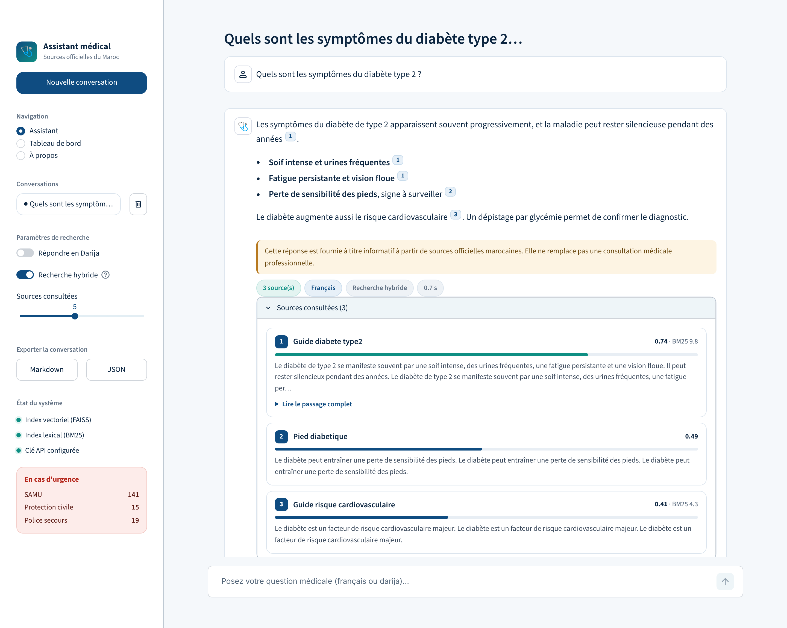
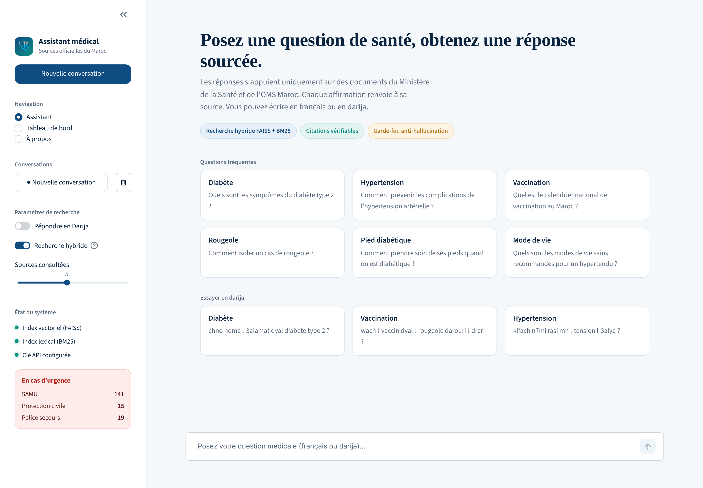
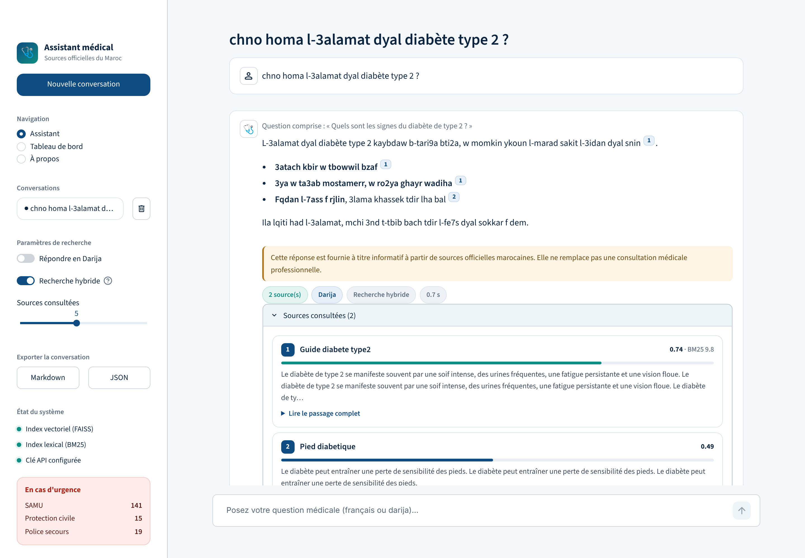
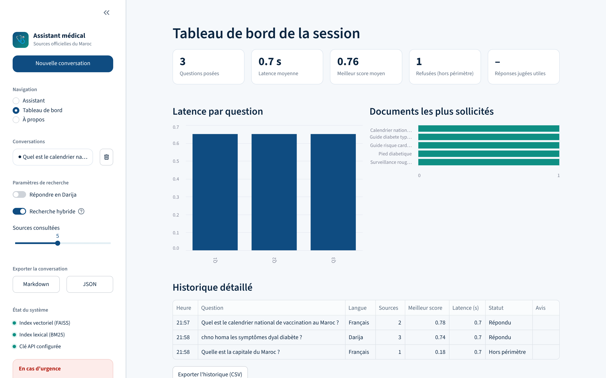
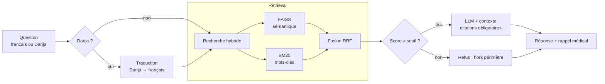

<div align="center">

# 🩺 Assistant Médical Marocain

**Chatbot d'information médicale basé sur une architecture RAG hybride (FAISS + BM25), alimenté uniquement par des sources officielles marocaines, avec support de la Darija.**




</div>

---

## Sommaire

- [Présentation](#présentation)
- [Fonctionnalités](#fonctionnalités)
- [Aperçu](#aperçu)
- [Architecture](#architecture)
- [Installation](#installation)
- [Configuration](#configuration)
- [Utilisation](#utilisation)
- [Structure du projet](#structure-du-projet)
- [Évaluation](#évaluation)
- [Tests](#tests)
- [Limites et avertissement](#limites-et-avertissement)
- [Pistes d'amélioration](#pistes-damélioration)
- [Contexte académique](#contexte-académique)
- [Auteurs](#auteurs)
- [Licence](#licence)

---

## Présentation

Les modèles de langage répondent de façon fluide, mais peuvent inventer des informations, ce qui est un risque
majeur en santé. Ce projet limite ce risque avec une approche **RAG (Retrieval-Augmented Generation)** : le modèle ne répond qu'à partir de passages
retrouvés dans des documents officiels (Ministère de la Santé et de la Protection sociale, OMS Maroc), et
**cite ses sources** pour chaque affirmation.

Si aucun passage n'est suffisamment pertinent, l'assistant **refuse de répondre** au lieu d'improviser.

## Fonctionnalités

### Moteur RAG

| Fonctionnalité | Description |
| --- | --- |
| **Recherche hybride** | Combine la recherche sémantique (FAISS) et lexicale (BM25) par fusion de rangs *Reciprocal Rank Fusion*, pour mieux traiter les sigles et noms de maladies. Désactivable. |
| **Citations obligatoires** | Chaque affirmation renvoie à sa source (`[Source 1]`, `[Source 2]`…). |
| **Garde-fou de pertinence** | Sous un seuil de similarité, la question est jugée hors périmètre et le LLM n'est pas appelé (moins d'hallucinations, moins d'appels API). |
| **Support de la Darija** | Détection de la Darija en écriture latine, traduction vers le français avant la recherche, réponse possible en Darija. |
| **Rappel médical systématique** | Ajouté dans le code après chaque réponse, indépendamment du LLM. |

### Interface web

- Conversations multiples (création, bascule, suppression)
- Réponses affichées en flux, citations rendues en pastilles numérotées
- Cartes de sources : document, barre de pertinence, scores FAISS/BM25, extrait et passage complet
- Indicateurs par réponse : langue, mode de recherche, nombre de sources, latence
- Retour utilisateur 👍 / 👎 par réponse
- Tableau de bord de session : latence, pertinence, documents sollicités, export CSV
- Export des conversations en Markdown et JSON
- État du système (index FAISS, index BM25, clé API) et numéros d'urgence toujours visibles
- Questions suggérées en français et en Darija

## Aperçu

| Accueil | Exemple en Darija |
| :---: | :---: |
|  |  |

| Tableau de bord |
| :---: |
|  |

> Les captures utilisent des données de démonstration.

## Architecture



**Pipeline de données** (hors ligne) :

```
Scraping / PDF officiels → Extraction → Nettoyage → Chunking (500 tokens, overlap 80)
→ Embeddings → Index FAISS + Index BM25
```

## Installation

**Prérequis** : Python 3.10 ou supérieur et un jeton d'accès à une API compatible OpenAI
(par défaut [GitHub Models](https://github.com/marketplace?type=models), gratuit avec limites de débit).

```bash
# 1. Cloner le dépôt
git clone https://github.com/<votre-compte>/medical_rag_chatbot.git
cd medical_rag_chatbot

# 2. Créer un environnement virtuel
python -m venv venv
source venv/bin/activate        # Windows : venv\Scripts\activate

# 3. Installer les dépendances
pip install -r requirements.txt

# 4. Configurer les clés
cp .env.example .env            # puis éditer .env
```

## Configuration

Les variables se définissent dans le fichier `.env` :

| Variable | Rôle | Valeur par défaut |
| --- | --- | --- |
| `GITHUB_TOKEN` | Jeton d'accès à l'API | *(obligatoire)* |
| `API_BASE_URL` | Point d'accès de l'API compatible OpenAI | `https://models.github.ai/inference` |
| `CHAT_MODEL` | Modèle de génération | `openai/gpt-4.1-mini` |
| `EMBEDDING_MODEL` | Modèle d'embeddings | `openai/text-embedding-3-small` |

**Obtenir un jeton GitHub Models** : sur [github.com/settings/tokens](https://github.com/settings/tokens),
créez un jeton classique (aucune permission particulière) ou un jeton *fine-grained* avec **Models → Read-only**.

> Avec GitHub Models, les identifiants de modèles portent le préfixe du fournisseur (`openai/...`).
> En cas d'erreur « model not found », vérifiez l'identifiant exact sur la
> [page des modèles](https://github.com/marketplace?type=models). Pour utiliser l'API OpenAI directement,
> changez `API_BASE_URL` et retirez le préfixe `openai/`.

**Paramètres du pipeline** (fichier `config.py`) :

| Paramètre | Valeur | Effet |
| --- | --- | --- |
| `CHUNK_SIZE_TOKENS` / `CHUNK_OVERLAP_TOKENS` | 500 / 80 | Taille et chevauchement des segments |
| `TOP_K` | 4 | Nombre de passages récupérés |
| `MIN_CHUNK_SCORE` | 0,28 | Score minimal pour conserver un passage |
| `LOW_RELEVANCE_THRESHOLD` | 0,22 | Seuil du garde-fou (en dessous : refus) |
| `TEMPERATURE` / `MAX_TOKENS` | 0,3 / 700 | Réponses factuelles et concises |

## Utilisation

### 1. Construire la base de connaissances

Tout en une commande :

```bash
python main.py
```

Ou étape par étape :

```bash
python -m src.scraping.web_scraper      # Scraping des pages + téléchargement des PDF officiels
python -m src.scraping.pdf_extractor    # Extraction du texte des PDF
python -m src.preprocessing.cleaner     # Nettoyage
python -m src.preprocessing.chunker     # Découpage en segments
python -m src.indexing.vector_store     # Index vectoriel FAISS
python -m src.indexing.bm25_index       # Index lexical BM25
```

La liste des sources (10 PDF du Ministère de la Santé et 2 PDF de l'OMS) se complète dans
`src/scraping/web_scraper.py` (`SOURCES` et `PDF_SOURCES`).

### 2. Lancer l'interface web

```bash
streamlit run app/streamlit_app.py
```

Lancez la commande **depuis la racine du projet** pour que le thème (`.streamlit/config.toml`) soit appliqué.

### 3. Utiliser le pipeline en Python

```python
from src.rag.pipeline import ask

result = ask("Quels sont les symptômes du diabète type 2 ?", top_k=5, use_hybrid=True)

print(result.answer)
for source in result.sources:
    print(source["source_document"], source.get("similarity_score"))
```

`ask()` renvoie un objet `RAGResult` : réponse, sources utilisées, question traduite,
langue détectée et indicateur de refus par le garde-fou.

## Structure du projet

```
medical_rag_chatbot/
├── app/
│   └── streamlit_app.py        # Interface web
├── src/
│   ├── scraping/               # Collecte : pages web et PDF
│   ├── preprocessing/          # Nettoyage et chunking
│   ├── indexing/               # Embeddings, FAISS, BM25
│   ├── rag/                    # Retriever, générateur, pipeline
│   ├── translation/            # Détection et traduction de la Darija
│   └── evaluation/             # Évaluation de la qualité
├── tests/                      # Tests unitaires
├── data/                       # raw/ · processed/ · chunks/ · index/
├── docs/screenshots/           # Captures d'écran du README
├── config.py                   # Configuration centrale
├── main.py                     # Pipeline complet de bout en bout
├── requirements.txt
└── .env.example
```

## Évaluation

Un module d'évaluation mesure la qualité du système sur un jeu de **16 questions réparties en 7 catégories**
(cardiovasculaire, diabète, vaccination, pédiatrie, santé publique, questions hors périmètre, Darija).

```bash
python -m src.evaluation.evaluator
```

Métriques calculées :

- pertinence du retrieval (score sémantique moyen)
- precision@k, avec un LLM comme juge
- fidélité de la réponse au contexte (détection d'hallucinations probables)
- comparaison RAG et LLM seul
- temps de réponse

## Tests

```bash
python -m pytest tests/
```

## Limites et avertissement

> ⚠️ **Ce projet fournit une information médicale générale à but éducatif. Il ne remplace en aucun cas
> une consultation avec un professionnel de santé et ne pose aucun diagnostic.**
> En cas d'urgence, appelez le **141 (SAMU)** ou le **15 (Protection civile)**.

- Les réponses dépendent des documents indexés : une information absente de la base ne sera pas trouvée.
- La détection de la Darija repose sur une heuristique de mots-clés en écriture latine ; l'écriture arabe n'est pas gérée.
- La qualité d'une réponse en Darija dépend du modèle de langage utilisé.
- Les scores de pertinence sont des indicateurs, pas une garantie d'exactitude médicale.

## Pistes d'amélioration

- [ ] Persistance des conversations entre les sessions
- [ ] Support de la Darija en écriture arabe
- [ ] Ré-ordonnancement des passages (*reranking*) avant la génération
- [ ] Authentification et journalisation pour un déploiement public
- [ ] Déploiement conteneurisé (Docker)

## Contexte académique

Projet de fin de module — **Programmation Python Avancée**
Université Chouaïb Doukkali, Faculté des Sciences, El Jadida — AU 2025/2026

## Auteurs

- **Nom Prénom** — [@votre-pseudo](https://github.com/votre-pseudo)
- **Nom Prénom** — [@pseudo-coequipier](https://github.com/pseudo-coequipier)

## Licence

Distribué sous licence **MIT**. Voir le fichier `LICENSE` pour plus de détails.
